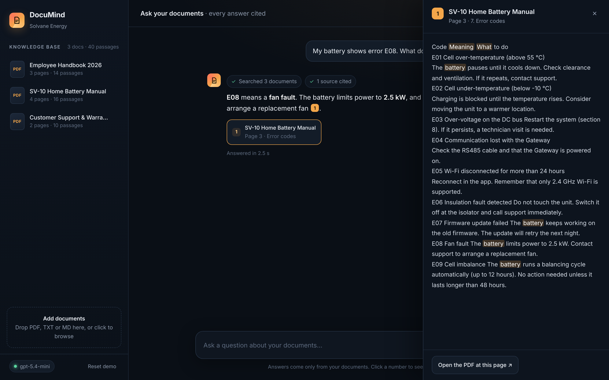

# DocuMind: AI answers from your own documents, with page-level citations


Upload PDFs (handbooks, manuals, policies, contracts) and ask questions in plain language. DocuMind finds the relevant passages and writes a short answer in which **every statement links to the exact page it came from**. If the documents don't contain the answer, it says so instead of guessing.



## What it does
- **Upload and index** PDF, TXT and Markdown files. Text is extracted page by page, section headings are kept with each passage, and running headers and footers are removed.
- **Hybrid search** combines semantic search (OpenAI embeddings) with keyword search (BM25) using reciprocal rank fusion, so it finds both paraphrased questions and exact codes like "E08".
- **Cited, streaming answers.** Click any `[n]` to see the source passage, highlighted, with a button that opens the PDF at that page.
- **Follow-up questions** are rewritten into standalone search queries, so "and for London?" works.
- **Any language:** it answers in the language of the question, even when the documents are in English.
- **Guardrails:** it answers only from the excerpts, refuses to guess, and has a basic rate limit for public demos.

## Stack
Python 3.11+, FastAPI, PyMuPDF, NumPy, OpenAI or Anthropic API, and a vanilla JS front end with no build step.

## Run it
```bash
pip install -r requirements.txt
export OPENAI_API_KEY=sk-...            # or ANTHROPIC_API_KEY=...
uvicorn app.main:app --port 8000        # open http://localhost:8000
```
Three sample documents for a fictional company (Solvane Energy) are indexed on first start. **Reset demo** restores them.

| Variable | Default | Purpose |
|---|---|---|
| `OPENAI_API_KEY` / `ANTHROPIC_API_KEY` | | model provider |
| `OPENAI_CHAT_MODEL` | first available of gpt-5-mini, gpt-4.1-mini, gpt-4o-mini | answer model |
| `EMBED_MODEL` | text-embedding-3-small | embeddings |
| `WORKSPACE_NAME` | Solvane Energy | name shown in the UI and prompt |

## Taking it to production
The storage layer (`app/store.py`) is small on purpose and keeps the same interface if you swap it for pgvector, Qdrant, Pinecone or Chroma. Typical additions:
- single sign-on and per-team document permissions
- OCR for scanned PDFs, plus DOCX and HTML import
- sync from Google Drive, SharePoint or Notion
- a Slack or Teams bot on the same API
- answer feedback and analytics
